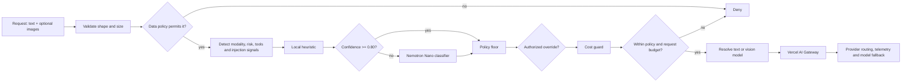

# Enterprise semantic model router on Vercel AI Gateway

[Nederlandse uitleg](README.nl.md) · [Architecture](docs/architecture.md) · [Model evidence](docs/model-selection.md) · [Cost governance](docs/cost-governance.md) · [Deployment](docs/deployment.md) · [Codex and Claude](docs/codex-claude-integration.md)

A production-minded reference implementation for an organisation-controlled LLM routing layer. It does not merely distribute traffic among providers. It interprets each request, enforces company policy, detects actual input modality, chooses a stable quality tier, applies a cost ceiling and then uses Vercel AI Gateway for authentication, provider routing, observability and model failover.

This repository extends Vercel's official [cost-aware model routing guide](https://vercel.com/kb/guide/cost-aware-model-routing-with-ai-gateway) into a reusable control-plane example for an organisation with 100+ people.

> Safe default: dry-run is enabled, internal and restricted data are denied, API keys are absent, and raw prompts/images are omitted from responses and application logs.

## What is implemented

- deterministic request validation and data-class gates;
- modality detection from actual base64 image input, not a caller-provided vision flag;
- separate text and image routes so text-only Nemotron models never receive image work;
- zero-latency heuristics for obvious tasks;
- a small NVIDIA Nemotron classifier only for low-confidence requests;
- four company-owned aliases: `fast`, `capable`, `frontier`, `premium`;
- hard minimum tiers for tools, injection signals and high-consequence use cases;
- a preflight cost guard that may reduce quality only above the policy minimum;
- a server-authorized model override that cannot bypass policy;
- Vercel model fallbacks, provider preferences, caching and privacy flags;
- optional per-tier Gateway API keys and Vercel budgets;
- low-cardinality tags and salted opaque user telemetry;
- task-specific, injection-aware system prompts;
- a synthetic routing evaluation dataset and deterministic tests;
- a local MCP adapter so Codex and Claude Code can call the router as a tool;
- a small UI for route-only and route-and-generate inspection.

## Control flow



Vercel Gateway is the execution plane. This repository owns the semantic decision. A Gateway model fallback is an availability mechanism; it is not the same as selecting the right model for the request.

## Current model policy

Model IDs are isolated in [`src/catalog/models.js`](src/catalog/models.js). Application code uses aliases.

| Tier | Text route | Image route | Intended use |
|---|---|---|---|
| `fast` | NVIDIA Nemotron 3 Nano 30B A3B | Google Gemini 3.5 Flash-Lite | bounded transforms, extraction, classification, high throughput |
| `capable` | NVIDIA Nemotron 3 Super 120B A12B | Google Gemini 3.5 Flash | code, SQL, structured analysis, tool-oriented work |
| `frontier` | OpenAI GPT-5.6 Terra | OpenAI GPT-5.6 Terra | ambiguous, long, adversarial or high-consequence reasoning |
| `premium` | Anthropic Claude Opus 5 | Anthropic Claude Opus 5 | explicitly justified maximum-quality work |

Why these candidates:

- Vercel's live catalog confirms model availability, modalities, context and current Gateway price.
- Artificial Analysis provides independent snapshots for intelligence, speed, latency, verbosity and modality support.
- the repository evaluation set determines whether a candidate is fit for this policy and workload.

Artificial Analysis is evidence, not an automatic truth oracle. Benchmark effort settings may differ from Gateway defaults, generic scores do not prove performance on a company's tasks, and provider latency changes. See [model-selection.md](docs/model-selection.md) for the dated evidence and limitations.

## Quick start

Prerequisites: Node.js 20+ and a Vercel account if you want live generation.

```bash
git clone https://github.com/juukan/vercel-ai-gateway-enterprise-router.git
cd vercel-ai-gateway-enterprise-router
npm ci --ignore-scripts
cp .env.example .env.local
npm run dev
```

On PowerShell:

```powershell
Copy-Item .env.example .env.local
npm run dev
```

Open `http://localhost:3000`. With `ROUTER_DRY_RUN=true`, the app returns routing metadata but does not generate. To call a model locally, set `AI_GATEWAY_API_KEY` and change `ROUTER_DRY_RUN=false`. On Vercel, [OIDC authentication](https://vercel.com/docs/ai-gateway/authentication-and-byok) can avoid a long-lived general Gateway key.

Never commit `.env.local`.

## API

Route without generation:

```bash
curl http://localhost:3000/api/route \
  -H "content-type: application/json" \
  -H "authorization: Bearer YOUR_ROUTER_TOKEN" \
  -d '{
    "prompt": "Compare two migration options and identify evidence gaps.",
    "usage": "analysis",
    "dataClass": "public",
    "maxOutputTokens": 900,
    "maxCostUsd": 0.02,
    "capabilities": { "tools": false, "strictJson": false },
    "orgUnit": "platform"
  }'
```

Use `/api/generate` for generation. Image input is supported as up to four base64 PNG, JPEG, WEBP or GIF data URLs, at most 5 MB each:

```json
{
  "prompt": "Explain the anomaly in this chart and provide alternative hypotheses.",
  "usage": "analysis",
  "dataClass": "public",
  "images": [{ "dataUrl": "data:image/png;base64,BASE64_IMAGE_DATA" }]
}
```

Remote image URLs and SVG are rejected to reduce SSRF and active-content risk. Production deployments should additionally scan uploads, inspect decompressed dimensions, use an object quarantine flow and set platform-level body limits.

The reference fails closed when `maxCostUsd` is combined with images because provider-specific image tokenization is required for a defensible request cap. Use tier-key budgets for image traffic or add a validated image-cost estimator.

## Override behavior

`forceModelAlias` is deliberately privileged. The normal API bearer token does not authorize it. Supply a separate admin token through `x-routing-admin-authorization: Bearer ...`. Even an authorized operator cannot force a tier below the policy minimum.

This is a compact reference boundary. In a real organisation, replace the static admin token with identity-aware RBAC, an approval reason, expiry, audit event and break-glass monitoring.

## Cost guidance for 100+ people

The included 150-person scenario assumes 39,600 monthly requests, a 68/25/6/1 percent tier mix and 20 percent classifier use. At the dated Vercel price snapshot, the illustrative model subtotal is about **$101.63/month**, or **$137.19 with a 35% buffer**.

That is a calculator demonstration, not a forecast. It excludes Vercel plan costs, taxes, reporting-cardinality charges, storage, egress, retries, fallback price differences, tools, image-token accounting and engineering. Real token volume can move the result by orders of magnitude.

```bash
npm run costs
npm run models:check
```

Do not budget from employee count alone. Run shadow routing, measure tokens and quality by use case, then create separate Gateway keys and budget caps for environment and tier. Full guidance is in [cost-governance.md](docs/cost-governance.md).

## Verification

```bash
npm test
npm run eval:routing
npm run test:security
npm run costs
npm run build
```

`models:check` is intentionally separate because it needs network access and should trigger a review, not silently update prices.

## Codex and Claude Code

The included stdio MCP adapter exposes two tools:

- `route_request`: inspect the decision without generation;
- `route_and_generate`: execute a permitted routed subtask.

This integrates the router as a controlled tool. It does **not** silently replace Codex's or Claude Code's own base model, and it does not pretend to be an OpenAI Responses or Anthropic Messages proxy. See [codex-claude-integration.md](docs/codex-claude-integration.md) for commands and limitations.

## Organisation rollout

1. **Inventory** use cases, data classes, required modalities and current spend.
2. **Shadow** routing without changing the serving model.
3. **Evaluate** route accuracy and answer quality on synthetic and approved real cases.
4. **Canary** low-risk public workloads with a kill switch.
5. **Enforce** data policy, RBAC, tier keys, budgets and monitoring.
6. **Expand** only after each use case has quality, privacy and business owners.
7. **Re-certify** on model, provider, prompt, price or policy changes.

The detailed gates and metrics are in [evaluation-and-rollout.md](docs/evaluation-and-rollout.md).

## NVIDIA Switchyard

[NVIDIA NeMo Switchyard](https://github.com/NVIDIA-NeMo/Switchyard) is relevant as an emerging open routing framework and possible future replacement for the small classifier module. Its repository still describes it as pre-alpha and experimental, so this project treats it as a watch item rather than a production dependency. The assessment, including Nemotron-Flash licensing and Gateway availability, is in [switchyard-watch.md](docs/switchyard-watch.md).

## Repository map

```text
app/                         Next.js UI and API routes
src/routing/                 validation, policy, heuristic, classifier, orchestration
src/gateway/                 Vercel AI Gateway model execution
src/catalog/                 stable aliases and dated model-price snapshot
src/cost/                    request cost estimation and policy-aware guard
src/prompts/                 classifier and task system prompts
src/security/                API and override token checks
src/telemetry/               privacy-conscious Gateway metadata
datasets/                    synthetic routing evaluation cases
scripts/                     eval, cost, price-drift and secret checks
tools/                       dependency-free local MCP adapter
docs/                        architecture, evidence, governance and rollout
```

## Non-goals

- claiming compliance from configuration flags alone;
- letting a model override hard data or authorization policy;
- logging raw prompts for convenience;
- auto-adopting the current benchmark leader;
- guaranteeing cost from a static price snapshot;
- replacing human approval in high-consequence decisions;
- serving as a full protocol-compatible proxy for every coding agent.

## License and attribution

MIT. The implementation is original reference code informed by Vercel's published cost-aware routing pattern. Source links and freshness dates are maintained in [source-ledger.md](docs/source-ledger.md).
